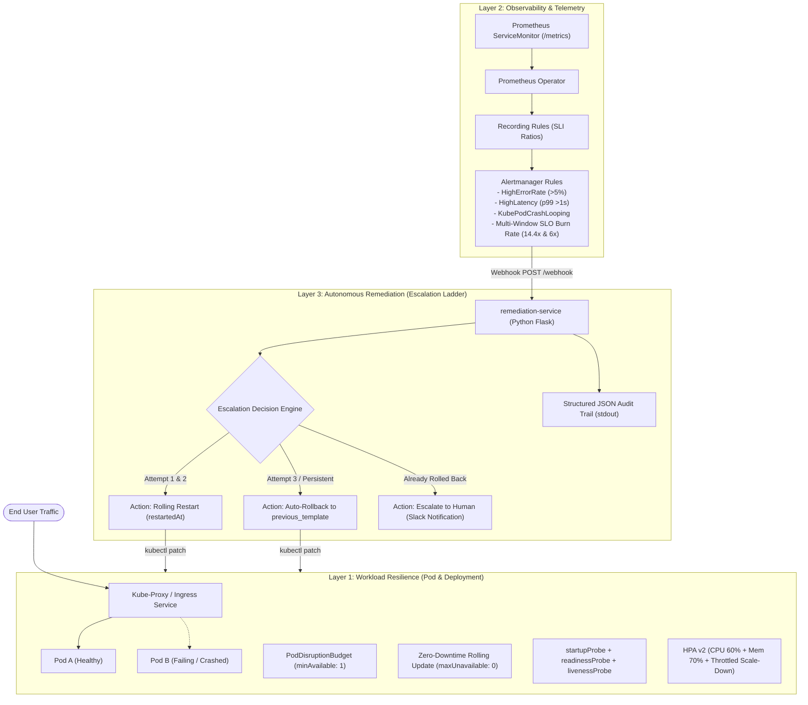

# Autonomous Resilience & Self-Healing Cloud Platform

A multi-layered Kubernetes platform featuring **zero-downtime deployments**, **SLO multi-window burn rate observability**, **autonomous incident remediation with an escalation ladder**, and **chaos engineering benchmarks with automated MTTR verification**.

---

## Architecture Overview

The platform is designed around a three-tier defense-in-depth model:



---

## Defense in Depth: The 3 Layers

### Layer 1: Application-Level Resilience
Configured via GitOps in [`gitops-config/base/`](../gitops-config/base/):
- **Startup Protection (`startupProbe`):** Allocates a 30-second budget (10 checks × 3s) for application warm-up and DB connection pools before liveness probes are armed, preventing premature kill loops.
- **Immediate Ingress Isolation (`readinessProbe`):** Unregisters degraded pods from service endpoints within 5 seconds, shielding users from 500 errors before container termination.
- **Zero-Downtime Guarantee:** `maxUnavailable: 0` and `maxSurge: 1` enforce that new pods must pass readiness checks before older pods can be terminated.
- **Node Drain Protection (`PodDisruptionBudget`):** `minAvailable: 1` ensures cluster maintenance, upgrades, or node evictions can never drain all replicas simultaneously.
- **Dynamic Capacity (`HorizontalPodAutoscaler v2`):** Autoscales between 2 and 5 replicas on CPU (60%) or memory (70%) utilization with a 5-minute stabilization window to prevent rapid scale thrashing.

### Layer 2: Observability & Multi-Window SLO Burn Rates
Configured in [`monitoring/platform-app-rules.yaml`](monitoring/platform-app-rules.yaml):
- **SLO Targets:** 99.9% Availability (Error Budget = 0.1% or ~43.2 min/month) and 99% Latency < 500ms over 30-day rolling windows.
- **Multi-Window Burn Rate Alerts (Google SRE Standard):**
  - **Fast Burn (`14.4x`):** Evaluates 1h and 5m windows simultaneously. Consumes 100% of the monthly error budget in ~50 hours $\rightarrow$ **Pages immediately (Critical)**.
  - **Slow Burn (`6.0x`):** Evaluates 6h and 30m windows simultaneously. Consumes budget in ~5 days $\rightarrow$ **Warning ticket**.
- **Symptom Alerts:** `HighErrorRate` (>5% 5xx for 2m), `HighLatency` (p99 >1s for 3m), and `KubePodCrashLooping` (>3 restarts in 15m).

### Layer 3: Autonomous Remediation Escalation Ladder
Implemented in [`remediation/webhook_handler.py`](remediation/webhook_handler.py):
When an alert fires, the service selects an action from a strict escalation ladder:

```
Alert 1 (First Failure)   ──> RESTART  (restart 1 of 2 allowed per hour)
Alert 2 (Still Failing)   ──> RESTART  (restart 2 of 2 allowed per hour)
Alert 3 (Restart Limit)   ──> ROLLBACK (rolled back to last functionally different revision)
Alert 4 (Still Failing)   ──> ESCALATE (alert to Slack; no further automated mutation)
```

#### The `previous_template` Rollback Algorithm
A common flaw in naive rollback scripts is reverting to `revision - 1`. Because deployment restarts patch the `kubectl.kubernetes.io/restartedAt` annotation, each restart increments the ReplicaSet revision. A naive rollback would simply roll back to the *previous restart of the same broken code*.

Our algorithm cleans and sanitizes ReplicaSet pod templates:
1. Strips ephemeral fields: `pod-template-hash` and `kubectl.kubernetes.io/restartedAt`.
2. Serializes and diffs historical ReplicaSet templates against the current running template.
3. Automatically selects the latest revision that is **genuinely and functionally different**.

#### Built-in Guard Rails
- **Per-Deployment Cooldown:** `COOLDOWN_SECONDS=300` prevents thundering-herd interventions.
- **Hourly Rate Limiting:** `MAX_ACTIONS_PER_HOUR=6` caps total automated mutations.
- **Namespace Allowlist:** `ALLOWED_NAMESPACES="development"` confines blast radius.
- **Structured Audit Logging:** Every action emits a machine-parseable JSON line (`AUDIT {...}`).
- **Slack Notifications:** Dispatches state changes to Slack or Discord webhook without leaking URLs into code.

---

## Chaos Engineering & MTTR Benchmarks

All failure recovery mechanisms were empirically tested and validated using the automated chaos harness in [`chaos/chaos_runner.py`](chaos/chaos_runner.py).

Full report: [`chaos/MTTR_REPORT.md`](chaos/MTTR_REPORT.md)

| Chaos Scenario | Injected Failure | Recovery Mechanism | Measured MTTR | User Impact |
| :--- | :--- | :--- | :--- | :--- |
| **Pod Eviction / Crash** | Sudden pod deletion under live ingress traffic (10 req/s) | K8s ReplicaSet + Readiness Probe + PDB | **6.77s** to full redundancy | **0 dropped requests (100% availability)** |
| **Bad Release Rollout** | Invalid image tag rollout (`ImagePullBackOff`) | Autonomous Remediation Escalation Ladder | **8.55s** full rollback | **0 human actions needed** |

---

## Operational Documentation

- [**Operational Runbook (`docs/RUNBOOK.md`)**](docs/RUNBOOK.md) — Step-by-step triage commands, PromQL queries, and manual recovery procedures for all firing alerts.
- [**Incident Postmortem Example (`docs/POSTMORTEM_EXAMPLE.md`)**](docs/POSTMORTEM_EXAMPLE.md) — Blameless postmortem of an automated bad release recovery with 5 Whys analysis.
- [**Postmortem Template (`docs/POSTMORTEM_TEMPLATE.md`)**](docs/POSTMORTEM_TEMPLATE.md) — Standardized template for production incidents.

---

## Honest Limitations & Trade-Offs

1. **In-Memory Controller State:**
   - The remediation controller tracks restart history and cooldown timestamps in process memory under a Python thread lock.
   - *Limitation:* If the `remediation-service` pod restarts, its history is reset, and it assumes a single-replica controller. A distributed deployment would require Redis or a Kubernetes CRD state store.
2. **Rollback Boundary:**
   - Rollback only mutates the Deployment pod template (e.g., reverting a bad container image or bad environment variable).
   - *Limitation:* It cannot roll back database schema migrations, external API outages, or misconfigured ConfigMaps/Secrets. When rollbacks fail to restore health, the service hits the **Escalate** rung to pull in humans.
3. **Multi-Cluster / GitOps Drift:**
   - When the remediation service patches a deployment directly via Kubernetes API, it introduces drift against the GitOps repository. ArgoCD auto-sync must have automated self-healing coordination or commit the rollback back to Git.

---

## Key Interview Talking Points

- **"Restarts can't fix bad code, so the system escalates."** Transient memory leaks or deadlocks may be solved by a restart; broken binaries or invalid configs never will. The system allows 2 restarts, then executes a rollback, and finally escalates to a human.
- **"Rollbacks must be template-aware, not revision-aware."** Restarts generate new revisions that differ only by timestamps. Naive rollbacks fail by rolling back to the same broken image; our template sanitizer diffs actual spec definitions.
- **"Symptom alerts over cause alerts."** We alert on user-visible symptoms (error rate, p99 latency, SLO burn rate) rather than internal machinery, keeping on-call noise low and actionable.
